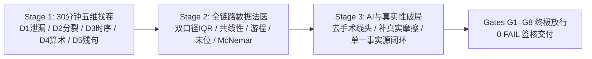

<div align="center">

# Thesis Audit

**通用学术与学位论文三阶极限审计 Skill：半小时地毯式找茬 · 全链路统计法医 · AI 与真实性破局**  
*A universal three-stage audit skill for academic & degree theses: rapid defect blitz, statistical data forensics, and authenticity recovery.*

[](LICENSE)
[](#自动化脚本工具箱)
[](#自动化脚本工具箱)
[](SKILL.md)

`Stage 1: 5-Dim Blitz ▶ Stage 2: Data Forensics ▶ Stage 3: Authenticity Recovery ▶ Gates G1–G8`

</div>

---

## 定位与边界（能做什么 / 不会做什么）

`thesis-audit` 是一套适用于**工科、理科、社科、经管、医学**等任意学科硕士/博士学位论文及实证期刊论文的审前极限核查与质询方法论工具箱。

| 会做（What It Does） | 不会做（What It Does NOT Do） |
|---|---|
| 扫描 `.md` / `.txt` / `.docx` 中残留的未渲染 Markdown 符号、批注/修订、草稿行号、调试种子与内部指令 | 不代写论文正文，也不代替作者进行文献调研或实验采集 |
| 对照合稿与分章段落指纹，自动排查“改了分章却漏同步合稿/附录”的跨载体分裂 | 不擅自篡改原始实测值或编造任何访谈/样本/DOI 以“凑平”统计检验 |
| 使用纯标准库对 `.csv` / `.tsv` / `.xlsx` 与文档二维表执行跨表加总、双口径 IQR、游程、共线性与末位数字检验 | 不把统计信号、句长 CV 或单一连接词当作“AI 代写/学术造假”的唯一绝对定罪证据 |
| 识别 AI 手术线头、无摩擦真空案例、未卜先知规则字典与机械断句残句，并给出闭环改写路径 | 不保证通过任何特定查重系统、商业 AIGC 检测器或特定评审人主观偏好 |

> **反误杀声明**：本仓库所有自动化正则与统计阈值均属**审查线索（Clues, Not Blacklists）**，内置三阶否定语境豁免窗口与代码块隔离机制；纯理论/纯质性无台账论文在 Stage 2 提供合法的 `N/A` 豁免分支。

---

## 为什么需要 Thesis Audit

许多论文在提交盲审或终稿归档前，作者自跑“格式脚本”显示全绿，却在评委或答辩现场暴露出致命硬伤：
1. **排版与源码分裂**：Markdown 转 Word 时表格单元格残留 `**`、`` ` ``、`<br>`，目录清单页码与正文表题对不上，甚至正文与附录对同一样本的描述正面打架；
2. **跨表算术与时间线悖论**：把 18 个月累计总量直接充当年化收益、子表合计不平、或者把试运行复盘后才新增的规则倒填进事前基线实验；
3. **台账“合成感”遭质疑**：因同源难度基线或单人按序归档造成高共线性（$|r| > 0.90$）或游程规律，缺少测量学解释与稳健性指标而被误疑编造；
4. **AI 痕迹与次生断句病句**：正文充斥“公文三连排比”和零阻力真空案例，或为满足“压句长/降 AI”强行把完整长句切出“然而。”“研究表明。”等病句。

---

## 安装指南（Installation）

> **重要提示**：`Agent Skills` 加载器要求 **本地文件夹名称 = `SKILL.md` 中的 `name` = `thesis-audit`**。

### 方式一：通过 `npx skills` 一键安装（推荐）

```bash
# 安装到当前论文工作区（推荐用于单篇论文隔离审计）
npx skills add jhuang-edu/thesis-audit

# 或全局安装（用于长期审计多篇论文）
npx skills add jhuang-edu/thesis-audit --global
```

### 方式二：手动 `git clone` 安装

```bash
# 项目级安装（以 Claude Code / Codex / Antigravity 常见目录为例）
git clone https://github.com/jhuang-edu/thesis-audit.git .claude/skills/thesis-audit
# 或
git clone https://github.com/jhuang-edu/thesis-audit.git .agents/skills/thesis-audit

# 全局安装（macOS / Linux）
git clone https://github.com/jhuang-edu/thesis-audit.git ~/.claude/skills/thesis-audit
```

Windows PowerShell 全局安装：

```powershell
git clone https://github.com/jhuang-edu/thesis-audit.git "$env:USERPROFILE\.claude\skills\thesis-audit"
```

### 方式三：直接对 Agent 引用

在对话中直接指示你的 AI 编程/写作助手：
> “请先读取 `<path-to-skill>/thesis-audit/SKILL.md`，按照 Stage 1 → Stage 2 → Stage 3 工作流对当前目录论文执行全量审计，并严格附带精确锚点。”

---

## 三阶工作流总览



| 阶段 | 核心文档 | 解决的核心问题 |
|---|---|---|
| **Stage 1** | [`workflows/stage-1-rapid-blitz.md`](workflows/stage-1-rapid-blitz.md) · [`checklists/rapid-audit-50pt-template.md`](checklists/rapid-audit-50pt-template.md) | 30 分钟地毯式扫除 D1–D5 五十大高发隐患并锚定到行号/表号 |
| **Stage 2** | [`workflows/stage-2-data-forensics.md`](workflows/stage-2-data-forensics.md) · [`checklists/data-reconciliation-checklist.md`](checklists/data-reconciliation-checklist.md) | 跨表平账、双口径分位数核验、统计法医红旗鉴别与合伦理破局 |
| **Stage 3** | [`workflows/stage-3-authenticity-recovery.md`](workflows/stage-3-authenticity-recovery.md) · [`templates/remediation-matrix.md`](templates/remediation-matrix.md) | 识别 5 类真实性破绽、执行“源数据 ↔ 分章 ↔ 终稿”同步修复 |
| **交付门禁** | [`checklists/defense-and-blind-review-gate.md`](checklists/defense-and-blind-review-gate.md) · [`templates/audit-report-template.md`](templates/audit-report-template.md) | 通过 G1–G8 刚性闸门方允许签发提交终稿 |

---

## 自动化脚本工具箱

`scripts/` 下全部 5 个脚本**严格仅依赖 Python 3.8+ 标准库**（无需 `pip install` 任何第三方包，原生 OpenXML 解析 `.docx` 与 `.xlsx`），Windows 与 Linux 开箱即用：

```bash
# 1. 文档泄漏与合稿/分章对齐扫描
python scripts/doc_leak_scanner.py --inputs thesis.docx drafts/ --compare full.md ch1.md ch2.md --format json

# 2. 跨表加总（含纵向合并单元格防护）、图表连续性与自定义跨表断言
python scripts/cross_table_reconciler.py --docs thesis.md --rules rules.json --tol 0.05 --format json

# 3. 台账数据法医审计（双口径 IQR、Pearson/Spearman、游程、末位、Benford、Kappa/McNemar）
python scripts/data_forensics.py --input ledger.xlsx --sheet Sheet1 --id-col id --group-col group --ref-col human --pred-col model --format json

# 4. 中英文混排句长 CV、机械断句残句与 AI 连接词/套话密度检查
python scripts/prose_rhythm_audit.py --inputs thesis.md --lang auto --min-cv 0.35 --max-sent 160 --exclude-headings 参考文献,致谢

# 5. 自检本 Skill 规范合规性并运行隔离夹具单元测试
python scripts/validate_skill.py --run-tests --format json
python -m unittest discover -s tests -v
```

---

## 仓库目录结构

```text
thesis-audit/
├── SKILL.md                                  # <=200行瘦路由入口与硬边界声明
├── README.md                                 # 中英双语说明与 CLI 快速上手
├── LICENSE                                   # MIT License
├── .gitignore                                # 忽略缓存/临时锁文件，保留 tests/fixtures/
├── .github/workflows/validate-skill.yml      # GitHub Actions 自动校验与主题标记
├── workflows/
│   ├── stage-1-rapid-blitz.md                # Stage 1：半小时五维找茬工作流
│   ├── stage-2-data-forensics.md             # Stage 2：全链路数据校验与法医挑战
│   └── stage-3-authenticity-recovery.md      # Stage 3：AI 与真实性质询及闭环修复
├── checklists/
│   ├── rapid-audit-50pt-template.md          # D1–D5 五大维度 50 点检查清单模板
│   ├── data-reconciliation-checklist.md      # 样本守恒/口径/复算/法医响应 24 项清单
│   └── defense-and-blind-review-gate.md      # G1–G8 终稿交付刚性一票否决闸门
├── templates/
│   ├── audit-report-template.md              # 标准化核查挑战报告模板
│   └── remediation-matrix.md                 # 多端单一事实源修复闭环矩阵
├── references/
│   ├── five-dimension-taxonomy.md            # D1–D5 缺陷分类学与三阶豁免规则图谱
│   ├── statistical-forensics-guide.md        # 统计法医数学公式、阈值与误判边界
│   ├── ai-and-fabrication-tells.md           # 5 大 AI 与编造破绽识别及去伪存真指南
│   └── case-study-desensitized.md            # 完全脱敏的极限审计实战复盘
├── scripts/
│   ├── doc_leak_scanner.py                   # 泄漏扫描、三阶否定豁免与合稿对齐
│   ├── cross_table_reconciler.py             # 跨表算术、vMerge/gridSpan、图表索引对账
│   ├── data_forensics.py                     # 统计复算与法医检验 (.csv/.tsv/.xlsx)
│   ├── prose_rhythm_audit.py                 # 混排智能分句、CV 节奏与残句/套话审计
│   └── validate_skill.py                     # V1–V8 Skill 规范校验与测试联动
└── tests/
    ├── test_scripts.py                       # 端到端单元测试（含合成 .docx/.xlsx 构造）
    └── fixtures/                             # 跨学科脱敏合成正反测试夹具
```

---

<details>
<summary><b>English Documentation (Expand)</b></summary>

## Overview

**Thesis Audit** (`thesis-audit`) is a discipline-agnostic, zero-dependency Agent Skill for pre-submission stress-testing of academic manuscripts and degree theses across `.md`, `.txt`, `.docx`, `.csv`, `.tsv`, and `.xlsx` files.

### What It Does & Does Not Do
- **Does**: Detects unrendered Markdown tokens, tracked changes/comments, draft line numbers, random seed leaks, and cross-file drift; reconciles table row/column arithmetic (handling Word `vMerge`/`gridSpan`), figure/table caption continuity, and list synchronization; runs statistical forensics (dual `INC`/`EXC` IQR, Pearson/Spearman collinearity, Wald-Wolfowitz runs, last-digit chi-square, narrow-range-guarded Benford, Cohen's Kappa, exact McNemar); flags broken prose fragments and AI connector clusters.
- **Does Not**: Ghostwrite thesis sections, fabricate or alter empirical ground-truth measurements, treat single stylistic clues as proof of AI authorship, or guarantee passage of external plagiarism/AIGC detectors.

### Installation

Loader requirement: **local directory name = `name` in `SKILL.md` = `thesis-audit`**.

```bash
# Recommended: project-scoped or global install via npx skills
npx skills add jhuang-edu/thesis-audit
npx skills add jhuang-edu/thesis-audit --global

# Or manual clone
git clone https://github.com/jhuang-edu/thesis-audit.git ~/.claude/skills/thesis-audit
```

### Three-Stage Workflow & Quality Gates
1. **Stage 1 (`workflows/stage-1-rapid-blitz.md`)**: 30-minute five-dimension blitz (`D1` internal artifacts, `D2` cross-carrier drift, `D3` timeline/rule paradoxes, `D4` arithmetic/unit imbalances, `D5` broken fragments & citation mismatches).
2. **Stage 2 (`workflows/stage-2-data-forensics.md`)**: Ledger verification and forensic diagnostics (with an explicit `N/A` waiver path for purely theoretical/qualitative theses).
3. **Stage 3 (`workflows/stage-3-authenticity-recovery.md`)**: Diagnosing AI surgery threads, frictionless vacuum cases, retrospective rule backfilling, and executing single-source-of-truth remediation before passing Gates **G1–G8**.

### Zero-Dependency Scripts (Python 3.8+ Stdlib Only)

```bash
python scripts/doc_leak_scanner.py --inputs manuscript.docx --compare full.md ch1.md ch2.md --format json
python scripts/cross_table_reconciler.py --docs manuscript.md --rules rules.json --tol 0.05 --format json
python scripts/data_forensics.py --input data.xlsx --id-col id --group-col grp --ref-col human --pred-col model --format json
python scripts/prose_rhythm_audit.py --inputs manuscript.md --lang auto --min-cv 0.35 --max-sent 160
python scripts/validate_skill.py --run-tests --format json
```

### License
MIT License — Copyright (c) 2026 jhuang-edu (`3588@duck.com`).

</details>

---

## 许可证（License）

本项目采用 [MIT License](LICENSE) 开源许可。反馈与交流联系：`3588@duck.com`。
