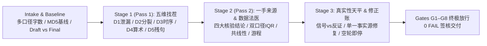

<div align="center">

# Thesis Audit Challenger (`thesis-audit-challenger`)

**通用学术与学位论文三阶极限审计、数据法医挑战与真实性质询 Skill**  
*A universal three-stage academic thesis & paper red-team audit skill: integrating two-layer primary-source verification with zero-dependency statistical data forensics and AI/authenticity interrogation.*

[](LICENSE)
[](#核心方法论融合两层一手来源核查--三阶数据与真实性挑战)
[](#自动化脚本工具箱)
[](#安装指南installation)
[](SKILL.md)

`Intake & MD5 Baseline ▶ Stage 1 (Pass 1): 5-Dim 50-100 Issue Blitz ▶ Stage 2 (Pass 2): Primary-Source Verification & Data Forensics ▶ Stage 3: Graded Authenticity & Correction Ledger ▶ Gates G1–G8`

</div>

---

## 核心方法论融合：两层一手来源核查 × 三阶数据与真实性挑战

`thesis-audit-challenger` 深度融合了考官级**“两层一手来源核查法（Two-Layer Primary-Source Audit）”**与**“零依赖自动化数据法医挑战（Automated Statistical Data Forensics & Authenticity Recovery）”**，适用于**法学、计算机/AI、经管/MBA、工科、理科、医学**等任意学科的学位论文及期刊/会议论文：

| 核心优势模块 | 方法论精髓与执行铁律 |
|---|---|
| **1. 全格式收稿与动态定基线**<br>*(Format-Aware Intake & MD5 Re-baselining)* | • 支持 `.md` / `.docx` / `.tex`（LaTeX 静态源码审计）/ `.pdf`（`pdftotext` + `pdfinfo` 元数据取证）与 `.csv/.tsv/.xlsx` 台账；<br>• **多口径字数矩阵**：一次性按仅正文、正文+摘要、全书含标点、中文字+英文词元各算一遍并排记录，终结字数上限争议；<br>• **MD5 增量重定基线**：记录文件 `MD5` 与修改时间，收到修订版时自动 `diff` 仅复核改动段落及其下游依赖；区分**草稿（Draft）**与**终稿（Final）**判准。 |
| **2. 第一层 / Stage 1：五维找茬与 Rubric 逐档核对**<br>*(First Pass: 50–100 Issues & Rubric Check)* | • 对照学校/期刊要求文档、模板与评分标准（Rubric band-by-band）通读全文，按连续序号定位 50–100 个硬伤（**绝不拿琐碎弱问题凑数，不够则实话实说**）；<br>• 覆盖 **D1 内部指令/行号泄漏、D2 跨载体分裂与符号残留、D3 时序穿越与学科自适应合规、D4 跨表算术与 ROI 错账、D5 机械断句残句与引证错配**；<br>• **严重度升档铁律**：分为 `S0/Blocker`、`S1/Major`、`S2-S3/Minor`，**级别拿不准时一律往高定一级并写明风险理由**。 |
| **3. 第二层 / Stage 2：一手来源全量核验 + 数据法医挑战**<br>*(Second Pass: Primary Sources & Data Forensics)* | • **一手来源铁律**：每个法条（对官方公报）、引文（对出版商/DOI）、案例（对法院/监管通报）、标准与数字逐条回一手来源复核；**结论里引的每个来源必须亲自打开看过，搜索摘要（Snippet）或二手转载绝不算来源**；每项给出唯一结论：`Confirmed（属实）` / `Discrepancy（有出入）` / `Unverifiable（无法验证）` / `Serious Error（严重错误）`；<br>• **7 大统计法医挑战**：可重跑脚本自动检验跨表加总、双口径 IQR（`INC` vs `EXC`）、线性乘数合成共线性（$|r|\ge 0.90$）、0/1 序列奇偶交替游程检验、抽样框阳性率倒挂、McNemar 精确检验与末位数字/Benford 偏态。 |
| **4. 第三层 / Stage 3：真实性分级裁决、修正账与可选短轮查**<br>*(Graded Authenticity, Correction Ledger & Rotating Rounds)* | • **三对判断严格分开**：*查不到 $\neq$ 编造*；*高度疑似 AI 辅助 $\neq$ 纯 AI 生成*；*引用马虎 $\neq$ 引用造假*；<br>• **取证信号 vs. 反证天平**：将异常元数据、AI 手术线头、零摩擦真空案例、未卜先知字典与“作者确实做出的精准专业区分（反证）”双向称重，输出**分级结论（Graded Verdict）**与**定稿前补证清单（查重报告、早期草稿、导师指导记录）**；<br>• **《修正账（Correction Ledger）》与空轮即停**：作者有异议立即回一手来源重核并记入修正账（撤回或附引文维持）；可选后续短轮查每次只盯一个旋转角度，**第一轮空轮（0 新发现）即停**。 |

---

## 定位与边界（能做什么 / 不会做什么）

| 会做（What It Does） | 不会做（What It Does NOT Do） |
|---|---|
| 扫描 `.md` / `.txt` / `.docx` 中残留的未渲染 Markdown 符号、批注/修订、草稿行号、调试种子与内部指令 | 不代写论文正文，也不代替作者进行文献调研或实验采集 |
| 对照合稿与分章段落指纹，自动排查“改了分章却漏同步合稿/附录”的跨载体分裂 | 不擅自篡改原始实测值或编造任何访谈/样本/DOI 以“凑平”统计检验 |
| 使用纯标准库对 `.csv` / `.tsv` / `.xlsx` 与文档二维表执行跨表加总、双口径 IQR、游程、共线性与末位数字检验 | 不把统计信号、句长 CV 或单一连接词当作“AI 代写/学术造假”的唯一绝对定罪证据 |
| 识别 AI 手术线头、无摩擦真空案例、未卜先知规则字典与机械断句残句，并给出闭环改写路径 | 不保证通过任何特定查重系统、商业 AIGC 检测器或特定评审人主观偏好 |

---

## 安装指南（Installation）

> **重要提示**：`Agent Skills` 加载器要求 **本地文件夹名称 = `SKILL.md` 中的 `name` = `thesis-audit-challenger`**。

### 方式一：通过 `npx skills` 一键安装（推荐）

```bash
# 安装到当前论文工作区
npx skills add jhuang-edu/thesis-audit-challenger

# 或全局安装
npx skills add jhuang-edu/thesis-audit-challenger --global
```

### 方式二：手动 `git clone` 安装

```bash
# 项目级或全局安装（macOS / Linux）
git clone https://github.com/jhuang-edu/thesis-audit-challenger.git ~/.claude/skills/thesis-audit-challenger
```

Windows PowerShell 全局安装：

```powershell
git clone https://github.com/jhuang-edu/thesis-audit-challenger.git "$env:USERPROFILE\.gemini\config\skills\thesis-audit-challenger"
```

---

## 三阶工作流总览



| 阶段 | 核心文档 | 解决的核心问题 |
|---|---|---|
| **Stage 1 (Pass 1)** | [`workflows/stage-1-rapid-blitz.md`](workflows/stage-1-rapid-blitz.md) · [`checklists/rapid-audit-50pt-template.md`](checklists/rapid-audit-50pt-template.md) | 收稿定基线 + 30 分钟地毯式扫除 D1–D5 50–100 项隐患并按 Rubric 定级 |
| **Stage 2 (Pass 2)** | [`workflows/stage-2-data-forensics.md`](workflows/stage-2-data-forensics.md) · [`checklists/data-reconciliation-checklist.md`](checklists/data-reconciliation-checklist.md) | 逐条回一手来源给出四大核验结论 + 跨表平账与 7 大统计法医红旗挑战 |
| **Stage 3** | [`workflows/stage-3-authenticity-recovery.md`](workflows/stage-3-authenticity-recovery.md) · [`templates/remediation-matrix.md`](templates/remediation-matrix.md) | 真实性三对分离、信号/反证双向称重、三端同步修复、修正账与可选旋转短轮查 |
| **交付门禁** | [`checklists/defense-and-blind-review-gate.md`](checklists/defense-and-blind-review-gate.md) · [`templates/audit-report-template.md`](templates/audit-report-template.md) | 通过 G1–G8 刚性闸门方允许签发提交终稿 |

---

## 自动化脚本工具箱

`scripts/` 下全部 5 个脚本**严格仅依赖 Python 3.8+ 标准库**（无需 `pip install` 任何第三方包，原生 OpenXML 解析 `.docx` 与 `.xlsx`）：

```bash
# 1. 文档泄漏与合稿/分章对齐扫描
python scripts/doc_leak_scanner.py --inputs thesis.docx drafts/ --compare full.md ch1.md ch2.md --format json

# 2. 跨表加总（含纵向合并单元格防护）、图表连续性与自定义跨表断言
python scripts/cross_table_reconciler.py --docs thesis.md --rules rules.json --tol 0.05 --format json

# 3. 台账数据法医审计（双口径 IQR、Pearson/Spearman、游程、末位、Benford、Kappa/McNemar）
python scripts/data_forensics.py --input ledger.xlsx --sheet Sheet1 --id-col id --group-col group --ref-col human --pred-col model --format json

# 4. 中英文混排句长 CV、机械断句残句与 AI 连接词/套话密度检查
python scripts/prose_rhythm_audit.py --inputs thesis.md --lang auto --min-cv 0.35 --max-sent 160 --exclude-headings 参考文献,致谢

# 5. 自检本 Skill 规范合规性并运行隔离夹具单元测试
python scripts/validate_skill.py --run-tests --format json
python -m unittest discover -s tests -v
```

---

## 仓库目录结构

```text
thesis-audit-challenger/
├── SKILL.md                                  # <=200行核心路由入口、收稿定基线与三大铁律
├── skill.yaml                                # 跨平台 Skill 元数据配置
├── README.md                                 # 中英双语说明、方法论融合矩阵与 CLI 快速上手
├── LICENSE                                   # MIT License
├── .gitignore                                # 忽略缓存/临时锁文件，保留 tests/fixtures/
├── workflows/
│   ├── stage-1-rapid-blitz.md                # Stage 1 (Pass 1)：收稿定基线 + 半小时五维找茬
│   ├── stage-2-data-forensics.md             # Stage 2 (Pass 2)：一手来源全量核验 + 数据统计法医挑战
│   └── stage-3-authenticity-recovery.md      # Stage 3：真实性双向称重、破局修复、修正账与可选短轮查
├── checklists/
│   ├── rapid-audit-50pt-template.md          # D1–D5 五大维度 50–100 点检查清单模板
│   ├── data-reconciliation-checklist.md      # 样本守恒/口径/复算/法医响应 24 项清单
│   └── defense-and-blind-review-gate.md      # G1–G8 终稿交付刚性一票否决闸门
├── templates/
│   ├── audit-report-template.md              # 含多口径字数表、Pass 2 四大核验结论表与真实性天平的报告模板
│   └── remediation-matrix.md                 # 多端单一事实源修复矩阵 + 争议《修正账》+ 短轮查日志
├── references/
│   ├── five-dimension-taxonomy.md            # D1–D5 缺陷分类学与三阶豁免规则图谱
│   ├── statistical-forensics-guide.md        # 统计法医数学公式、阈值与误判边界
│   ├── ai-and-fabrication-tells.md           # AI 与编造破绽识别及去伪存真指南
│   └── case-study-desensitized.md            # 完全脱敏的极限审计实战复盘
├── scripts/
│   ├── doc_leak_scanner.py                   # 泄漏扫描、三阶否定豁免与合稿对齐
│   ├── cross_table_reconciler.py             # 跨表算术、vMerge/gridSpan、图表索引对账
│   ├── data_forensics.py                     # 统计复算与法医检验 (.csv/.tsv/.xlsx)
│   ├── prose_rhythm_audit.py                 # 混排智能分句、CV 节奏与残句/套话审计
│   └── validate_skill.py                     # V1–V7 Skill 规范校验与测试联动
└── tests/
    ├── test_scripts.py                       # 端到端单元测试（含合成 .docx/.xlsx 构造）
    └── fixtures/                             # 跨学科脱敏合成正反测试夹具
```

---

## License

MIT License — see [LICENSE](LICENSE).
